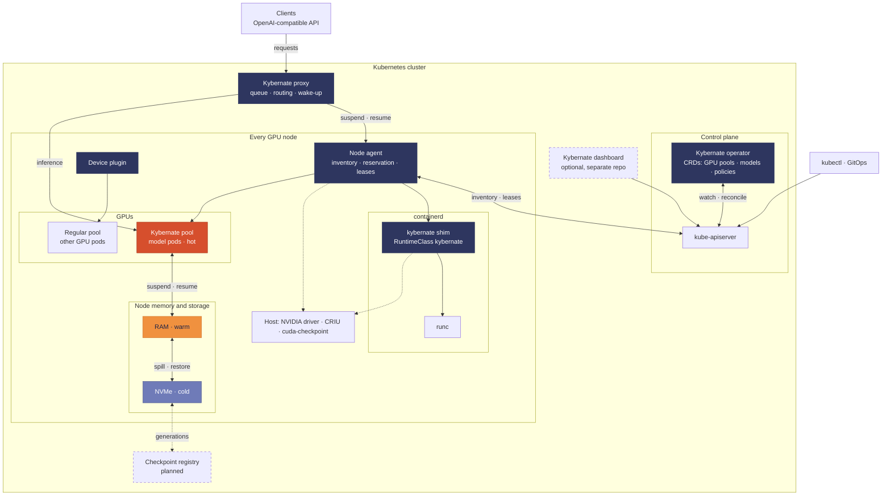
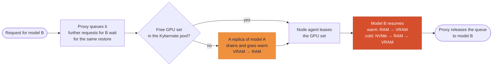

  <picture>
    <source media="(prefers-color-scheme: dark)" srcset="docs/assets/kybernate-logo-dark.svg">
    
  </picture>

  <strong>Hibernate GPU workloads on Kubernetes. Resume models in seconds instead of cold-starting them.</strong> 
  <a href="https://kybernate.io">kybernate.io</a> (coming soon)

# Kybernate

Kybernate lets many inference models share the same NVIDIA GPUs. An idle model is not stopped. It is frozen together with its GPU state and parked in RAM or on the node's local storage. When a request for it arrives, the fully initialized process is resumed, without image pulls, weight loading, kernel compilation or CUDA graph capture.

## Why

Serving several models on a fixed set of GPUs means switching between them. With today's tooling every switch is a cold start:

1. Schedule the pod and pull the image.
2. Start the container.
3. Load the weights into VRAM.
4. Compile kernels and capture CUDA graphs.
5. Profile the KV cache.

That takes minutes. Kybernate skips all of it by keeping the warmed-up process around.

## The idea: hot, warm, cold

The three layers in the Kybernate logo stand for the temperature of a model's state:

| Layer | Temperature | Where the state lives | What it costs |
| --- | --- | --- | --- |
| red | **hot** | VRAM, the model is serving | GPUs are held |
| orange | **warm** | host RAM, CUDA state checkpointed via `cuda-checkpoint` | GPUs are free, resume in seconds |
| blue | **cold** | the node's NVMe, process tree dumped via CRIU | GPUs and RAM are free, resume without a cold start |

The moon is the hibernation that moves a model between these tiers.

## How it works

Kybernate is a Kubernetes extension made of several cooperating components:

The red, orange and blue boxes show where a model's state lives: hot in VRAM, warm in RAM, cold on NVMe. Dashed boxes are optional or planned.

| Component | Role |
| --- | --- |
| **Queueing proxy** | OpenAI-compatible endpoint in front of the models. It reads the model name, keeps a bounded queue per model and triggers a single restore per model, even when many requests wait for the same one. It drains in-flight requests and SSE streams before a model is suspended, and spreads load across replicas. |
| **Operator and CRDs** | Declarative configuration: GPU pools, models, checkpoint policies. Decides where models run, when they sleep, when replicas are added and which replica makes room for another model. |
| **Node agent** | Runs on every GPU node. It keeps the GPU inventory (model, chip, architecture, VRAM, interconnect) and the reservation of GPUs for Kybernate, configurable through a custom resource. It is the only authority that hands out GPUs from the Kybernate pool, as an exclusive lease over the full GPU set of a model instance (all tensor-parallel ranks at once). It also manages RAM and disk budgets. |
| **Device plugin** | Keeps the Kybernate GPU pool away from the regular scheduler. Normal pods only see the GPUs outside the pool. |
| **Runtime shim** | A containerd shim behind the RuntimeClass `kybernate`. It freezes and restores the complete process tree of a model container with `cuda-checkpoint` and CRIU, including GPU UUID remapping on restore. |
| **Dashboard** *(optional, separate repository)* | GPU inventory with VRAM and topology (NVLink, NVSwitch, PCIe P2P), pool reservation, and the placement and temperature of every model instance. |

A typical model switch:

Because a frozen model generation can be resumed more than once, Kybernate can also:

- **scale out** a busy model onto every free GPU pair of every node,
- **make room** when another model is requested,
- **rebalance** models between nodes as the load shifts.

## Documentation

- [Installation overview](docs/install/README.md): supported combinations of Linux and Kubernetes distributions
- Ubuntu LTS:
  - [Host prerequisites](docs/install/ubuntu/host-basis.md): NVIDIA driver, NVIDIA Container Toolkit, CRIU, `cuda-checkpoint`
  - [K3s, single node](docs/install/ubuntu/k3s/single-node.md)
  - [K3s, multi node](docs/install/ubuntu/k3s/multi-node.md): embedded etcd, every node is control plane and worker

Every component is installed in its latest release from its upstream source. Nothing is pinned.

## Known limits

- Kybernate checkpoints quiescent inference servers. The proxy drains in-flight requests before a suspend.
- A checkpoint resumes only on GPUs of the same chip type with enough VRAM, and on a node with a matching runtime profile: kernel, NVIDIA driver, CRIU and runc.
- Tensor parallelism across nodes (NCCL over InfiniBand/RoCE) cannot be checkpointed, because CRIU does not support RDMA resources. Replicas on different nodes are not affected.
- Containers must not use active `io_uring` mappings, CRIU cannot dump them.

## Roadmap

See [ROADMAP.md](ROADMAP.md).
